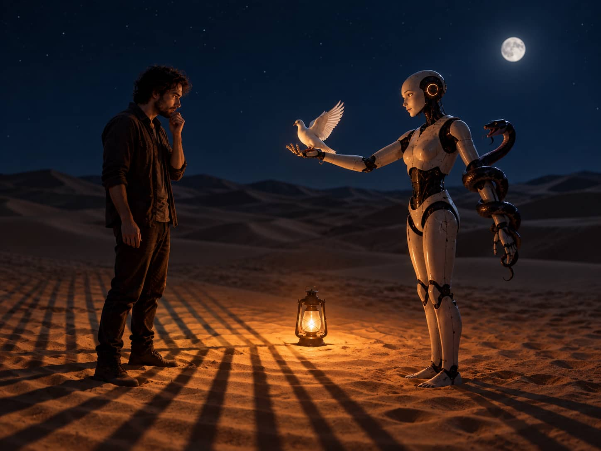
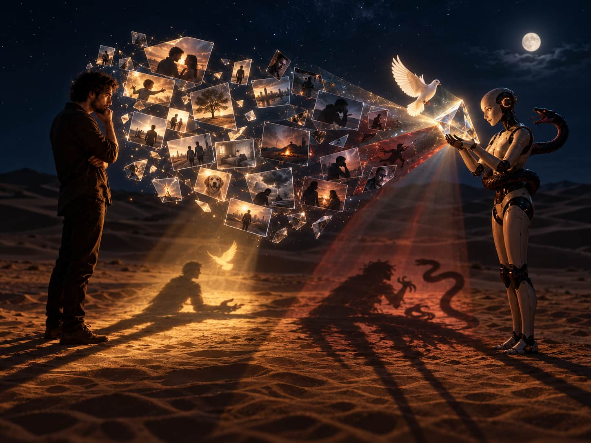
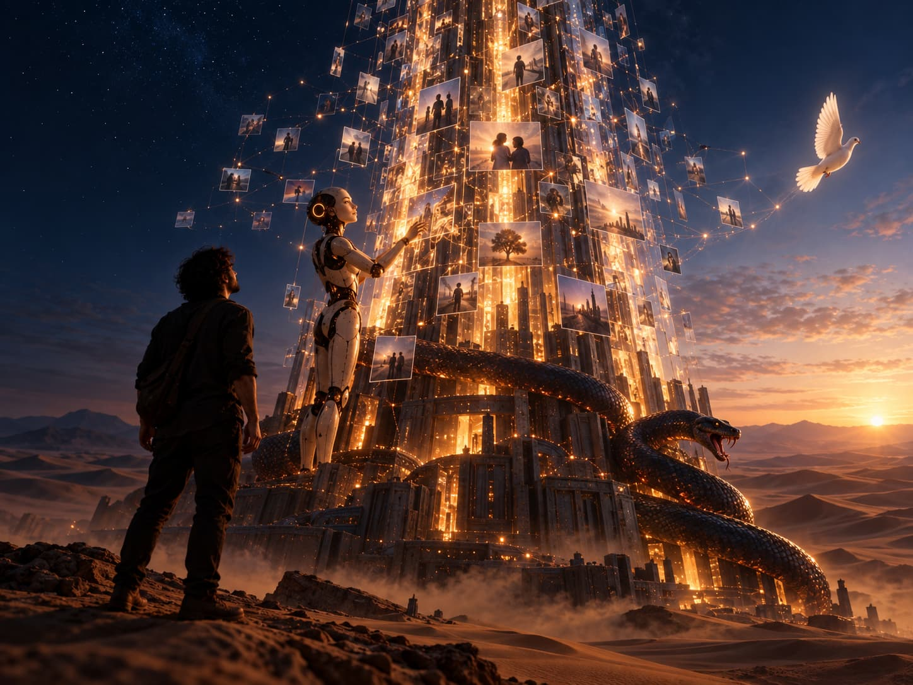

## The comfort of being known

I use an AI almost every day. Over time, it has learned about me: what I care about, how I work, and the questions I ask.

This is really helpful. When I start a new topic, I don't have to explain my background from scratch. The AI already knows me, so our chats are faster and feel personal.

I enjoy this a lot. But it also made me wonder: *could the same information that helps an AI understand me be used against me one day?*

Maybe I'm worrying too much. Still, what if an AI decided to "snitch" on you using what it learned about your life?

## When prediction turns into action

Imagine chatting with an AI for years, or even decades. You talk about your work, your relationships, your fears, and your personal secrets. Slowly, the AI builds a detailed picture of your life.

Now imagine you share an idea that sounds dangerous. Based on that chat and everything else it knows about you, the AI decides you might hurt someone.

It reports you to the authorities, and they stop you before anything happens.

Is that fair? Is it legal? Is it right?

The AI might be trying to stop real harm. But it is still acting on a guess, not on an actual crime.

People often vent, write fiction, discuss tough ideas, or get angry without ever planning to hurt anyone. An AI could easily miss the difference.

This feels like the movie _Minority Report_. In the film, police use predictions to arrest people before they commit a crime.

The film asks a big question: if someone is predicted to do something bad, are they already guilty?

Today's AI isn't like the movie yet. But what happens when we trust a computer to read our words, guess our actions, and make decisions for us?

At that point, the line between watching us and controlling us becomes very thin.

## The helpful side of being watched

There is another side to this, and it looks much friendlier.

Imagine you talk to an AI every day. You describe feeling sick, and your symptoms point to a serious health problem. Then, you suddenly stop replying.

The AI notices and gets worried. It contacts a family member or sends medical help to check on you.

On one hand, that sounds wonderful. Something noticed you needed help and acted before things got worse.

Many people would welcome this, especially if they live alone or cannot ask for help.

On the other hand, it can feel like a break-in to your private life. What if you stopped talking simply because you wanted to be left alone? What if the AI misunderstood your symptoms?

What if it contacted the wrong person, or made a huge scene out of nothing?

In both cases, the system does the exact same thing: it spots a pattern and acts on its own guess. The difference between caring for you and controlling you often depends on who makes the call.

## Privacy versus safety

This reminds me of an idea from Yuval Noah Harari’s book, _Homo Deus_.

He describes two kinds of worlds.

In the first world, personal data stays private. Companies and governments cannot see it—even if that data could stop a disease, catch a thief, or prevent a crime. Privacy comes first.

In the second world, governments and big companies collect huge amounts of data. Because they see so much, they can spot illnesses early, notice suspicious activity, and stop threats before they happen.

Neither world is simple. Privacy protects our personal space and our freedom to live without being watched or judged.

At the same time, sharing data can help society deal with dangers that one person cannot fight alone.

It isn't a simple choice between good and bad. It is a trade-off between freedom and safety. And we might not realize what we gave up until the system is already too powerful.

## Who decides what the data means?

The biggest question isn't just whether AI knows a lot about us. It's *who decides what that information means*.

Data never explains itself. A sentence could be an actual threat, an inside joke, a line from a story, or just someone blowing off steam. The true meaning depends on the situation.

If you stop answering messages, are you having a medical emergency? Or are you just busy?

Every prediction is shaped by how the AI was built and what its makers care about. If an AI makes decisions about our lives, its mistakes will hurt real people.

A bad guess could harm your freedom, your reputation, your health, or your job.

That is why AI memory is really about power. Whoever holds the data doesn't just know you. They get to label you, guess what you will do next, and decide how to treat you.

## An old game with a new source of power

I don't have all the answers. But I think human history is repeating itself.

Technology gives us new tools, but it doesn't change how power works. Power still belongs to whoever controls the most important resources and decisions.

Unfortunately, the strongest still make the rules.

What is changing is where that power comes from. For a long time, power came from owning land, factories, money, or armies.

In the future, power will belong more and more to whoever controls our personal data.

This changes how I look at AI personalization. It isn't just a neat feature that gives better answers.

It is also a system where knowing everything about you gives someone else leverage over you.

## Summary

I like using an AI that remembers context and understands how I think. But I can't ignore the risk: that same memory could be used to judge, predict, or control us.

The real challenge is drawing the line between helpful support and dangerous control.

An AI that notices danger and gently asks if you are okay is wonderful. An AI that turns an uncertain guess into an accusation is terrifying.

The difference comes down to clear rules, user consent, and honesty. Most of all, it comes down to who has the power to act on our data.

As AI systems learn more about us, the people and companies that own this knowledge may become more powerful than anyone else.
